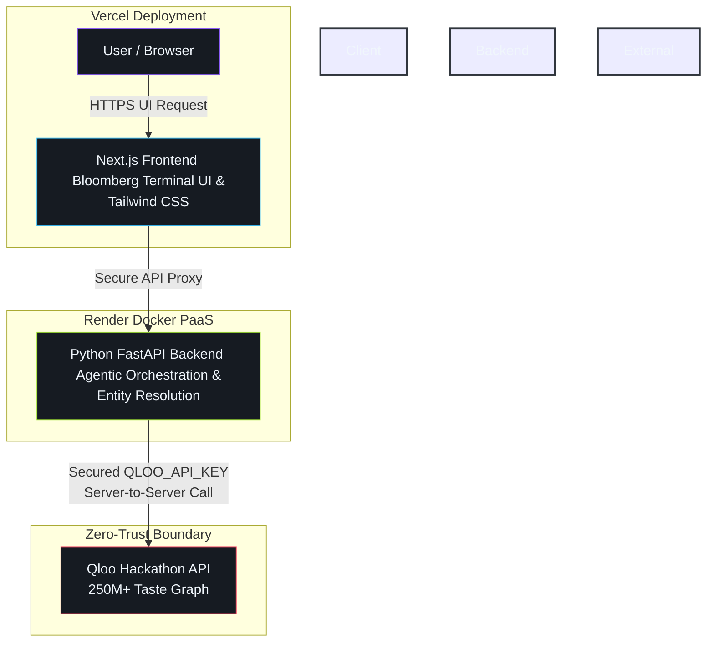

# ⚡ SparkCulture
 *The autonomous cultural IP & brand licensing engine powered by Qloo’s 250M+ entity taste graph.*

[](https://devpost.com)
[]()
[]()

---

## 🚀 Overview

**SparkCulture** solves a multi-billion-dollar blind spot in entertainment, media, and brand partnerships: *generic LLMs guess what people like; SparkCulture proves it using cultural intelligence.* 

By wiring autonomous agent workflows directly into Qloo’s taste graph, SparkCulture ingests any media IP, podcast, indie film, or brand and maps non-obvious cross-vertical brand partnerships, brutalist aesthetic blueprints, and high-margin product drops in seconds.

---

### 🌴 System Architecture

SparkCulture is engineered as a robust, decoupled monorepo optimized for low-latency execution and strict zero-trust security.


---

## ⚙️ Environment Configuration

SparkCulture enforces strict backend isolation. The `QLOO_API_KEY` is **never** exposed to the browser.

### 1. Backend Environment (`backend/.env`)
Create your environment file based on the safe template (`backend/.env.example`):

```env
QLOO_API_KEY=your_hackathon_api_key_here
QLOO_BASE_URL=https://hackathon.api.qloo.com
QLOO_TRUSTED_BASE_URL=https://hackathon.api.qloo.com
BACKEND_INTERNAL_URL=http://127.0.0.1:8000
FRONTEND_ORIGIN=http://localhost:3000

```
---
Environment Variable Reference
| Variable | Required | Default | Description |
|---|---|---|---|
| QLOO_API_KEY | Yes | — | Personal hackathon API key issued by Qloo. |
| QLOO_BASE_URL | Yes | https://hackathon.api.qloo.com | Target API host. Note: Hackathon keys do not work on production/staging hosts. |
| QLOO_TRUSTED_BASE_URL | No | https://hackathon.api.qloo.com | Trusted outbound host enforcing official hackathon routing. |
| BACKEND_INTERNAL_URL | No | http://127.0.0.1:8000 in development | Preferred backend URL reachable by the Next.js server. In production, configure this or `BACKEND_URL`. |
| BACKEND_URL | No | — | Alternate backend URL for the Next.js Route Handler. |
| FRONTEND_ORIGIN | No | http://localhost:3000 | Allowed browser origin(s), comma-separated. |

---

### 🛠️ Quick Start & Codespaces Setup
SparkCulture includes full containerization for GitHub Codespaces, providing an instant zero-config development environment with Python 3.11, Node.js, and automated port forwarding.
 * Clone or open the repository inside a GitHub Codespace.
 * Configure your backend .env file as shown above.
 * Boot the services:
Terminal 1 (Backend):

```
cd backend
python -m venv venv
source venv/bin/activate
pip install -r requirements.txt
export QLOO_BASE_URL=https://hackathon.api.qloo.com
export QLOO_TRUSTED_BASE_URL=https://hackathon.api.qloo.com
uvicorn main:app --reload --port 8000
```

Terminal 2 (Frontend):

```
cd frontend
npm install
npm run dev
```

The frontend proxies `POST /api/analyze-ip` through a Next.js Route Handler to FastAPI. For production, set `BACKEND_INTERNAL_URL` or `BACKEND_URL` to the backend address reachable from the Next.js server. When neither is set, the Route Handler uses `http://127.0.0.1:8000` only outside production; upstream failures are returned as JSON.

### 🧪 Validation & Quality Checks
Run the automated QA suites to ensure code health before deployment:
Frontend Validation (from /frontend)
```
npm run lint
npm run build
npm audit --omit=dev
```
Backend Syntax & Endpoint Tests (from root directory)
```
python -m py_compile backend/main.py
python backend/test_api.py
```

### 🔍 Troubleshooting Guide

```
| Symptom | Root Cause / Check | Solution |
|---|---|---|
| Backend exits at startup | Missing QLOO_API_KEY. | Create backend/.env from .env.example and insert your active hackathon key. |
| Qloo returns 401 Unauthorized | Invalid key or incorrect target host. | Verify key is active and requests target https://hackathon.api.qloo.com. The backend sends it via X-Api-Key. |
| 404 for a searched IP | Unresolved entity title. | Check title and vertical. Search results are resolved dynamically by Qloo; unmatched titles are not silently mocked. |
| 502 or 504 Gateway Error | Upstream Qloo timeout or service hitch. | Check Qloo API status, key permissions for requested entity types, network connectivity, and request payload structure. |
| Frontend cannot reach backend | Internal routing mismatch. | Confirm FastAPI is listening on port 8000 and `BACKEND_INTERNAL_URL` or `BACKEND_URL` points to an address reachable from the Next.js server. |
| No tag chips appear | Empty metadata response. | Description tags are optional; try adding concise context and re-submitting. |

```

### 🔒 Security & Data Compliance
 * Zero Client-Side Exposure: The QLOO_API_KEY lives exclusively in the backend environment. It is never transmitted to the browser or client application.
 * Git Safety: backend/.env is strictly ignored by .gitignore. In hosted environments (e.g., Render), secrets are securely injected via the platform's native secret manager.
 * Official Endpoints Only: All outbound calls use the official hackathon host (https://hackathon.api.qloo.com) and target documented endpoints (/search, /v2/tags, /v2/insights).
 * Resilient Outbound Transport: The backend disables automatic redirects on its outbound HTTP client and enforces strict bounded request timeouts to prevent hanging threads.


### 📁 Project Directory Structure

```
.devcontainer/       # GitHub Codespaces container & port configurations
backend/
  ├── .env.example   # Safe environment-variable template
  ├── main.py        # FastAPI core application & Qloo integration proxy
  ├── test_api.py    # Local endpoint tests & live Qloo smoke test suite
  └── requirements.txt # Pinned Python dependencies
frontend/
  ├── app/           # Next.js 15 App Router dashboard, layout, & styling
  ├── next.config.ts # Next.js configuration
  ├── app/api/       # Same-origin backend proxy Route Handlers
  └── package.json   # Frontend scripts & dependency manifests
```

## 📜 License
Distributed under the MIT License. See LICENSE file for details. Built for the Qloo Agentic Hackathon 2026.
